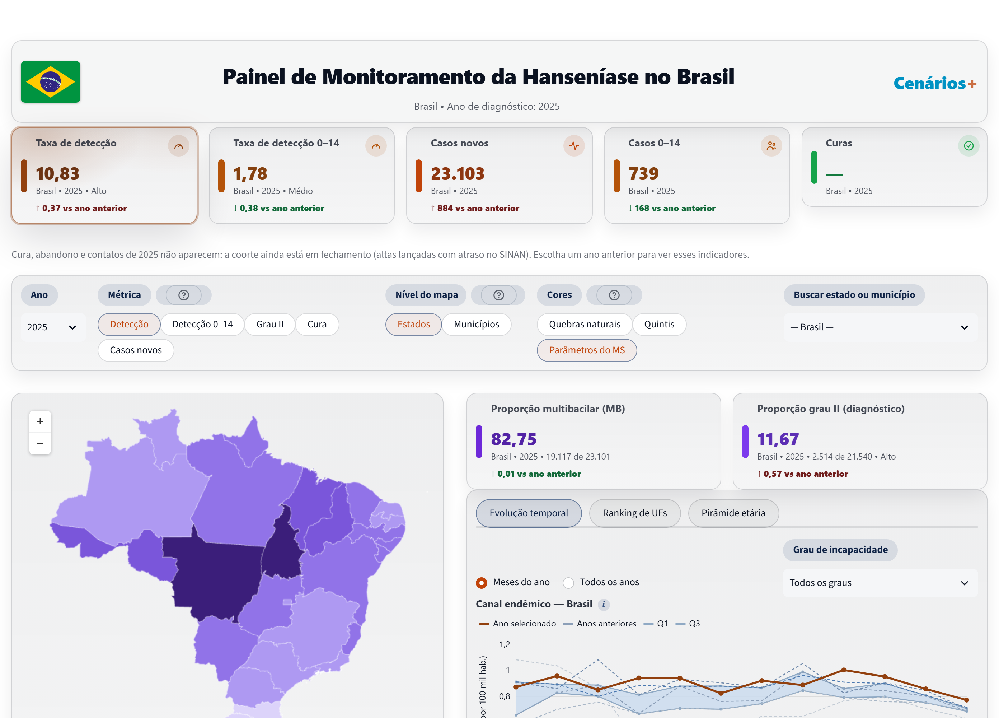

# Painel de Monitoramento da Hanseníase — Brasil

[](https://github.com/Dev-Cenarios/painel-hanseniase-brasil/actions/workflows/ci.yml)


Painel de vigilância da hanseníase do Brasil ao município, contado como o
Boletim Epidemiológico de Hanseníase do Ministério da Saúde.

**No ar:** <https://painel.cenarios.unb.br/cenarios/hansebr/>



**Linhagem:** `cenarios-core` (a mãe: mapa, gráficos, contenção de falha) →
`modelo` (o esqueleto) → **este painel**. Nasceu em 29/out/2026 com
`modelo/scripts/novo_painel.py`. O que é comum à família se corrige no core
e chega aqui trocando o wheel de `vendor/`; o que é só deste painel mora aqui.

## O que mostra

A tela é a do hansepe/hansedf: cinco cards (detecção geral e 0–14, casos
novos, casos 0–14, curas), mapa com a régua do MS, multibacilar e grau II,
canal endêmico, epicurva, ranking, pirâmide, indicadores de qualidade do
programa (cura, contatos, GIF avaliado, abandono), tópicos da ficha e séries
anuais.

Navegação **Brasil → UF → município**. No Brasil o mapa é por estado ou pelos
5.571 municípios; clicar num estado abre os municípios dele, clicar num
município mostra os números dele, clicar de novo volta um nível. Também há
busca por nome.

## De onde vêm os números

| Dado | Origem | Script |
|---|---|---|
| Notificações | `silver.hanseniase` (cenarios_ai), Brasil inteiro | `extrair_sinan_br` |
| Contatos registrados e examinados | `public.sinan_hans` (a silver não tem os registrados) | `extrair_contatos_br` |
| População | `public.pop_ibge` (IBGE/DataSUS), município × sexo × faixa de 5 anos | `extrair_populacao_br` |
| População de 2022 | Censo 2022, SIDRA tabela 4709 (o MS usa o Censo nesse ano) | `extrair_censo_2022` |
| Régua | Boletim Epidemiológico de Hanseníase do MS, nº especial jan/2026 | `extrair_boletim_ms` |

As contas seguem o boletim do MS (`src/fonte_sinan.py`): caso novo por ano
do diagnóstico e residência, sem erro diagnóstico; cura, abandono e contatos
na coorte (PB de A−1, MB de A−2, tirando só quem foi transferido para outro
estado ou país; cura só com alta até 31/12 de A); grau II sobre os avaliados.
A coorte do último ano da série aparece como **em fechamento** (altas são
lançadas com atraso). O levantamento e a distância até o boletim, Brasil e
UF, estão em `docs/levantamento.md`; `python -m scripts.conferir_boletim`
refaz a comparação.

## Rodar

Os scripts de banco precisam da VPN e das credenciais no `.env` (copie de
`.env.exemplo`; `CENARIOS_*` só no `.env`, nunca no exemplo).

```bash
python -m scripts.extrair_sinan_br
python -m scripts.extrair_contatos_br
python -m scripts.extrair_populacao_br
python -m scripts.extrair_censo_2022
python -m scripts.extrair_boletim_ms      # só pra conferência
streamlit run app.py                      # abre em http://localhost:8501
pytest                                    # sem data/origem os testes de dado pulam
```

A primeira carga calcula Brasil, UFs e municípios de uma vez (~10 s local,
~25 s na VM); depois fica em cache.

## Deploy

Na VM: pasta `~/hansebr`, container `dashboard-hansebr`, porta 8524, repo
`Dev-Cenarios/painel-hanseniase-brasil`, público. Os dados não estão no git nem na imagem: o compose
monta `./data`.

```bash
# código
ssh cenarios-vm 'cd ~/hansebr && git pull && docker compose up -d --build'

# dados (depois de rodar os scripts aqui)
tar -cf - data/origem/*.parquet | ssh cenarios-vm 'tar -C ~/hansebr -xf - && cd ~/hansebr && docker compose restart'
```

**O compose recusa subir sem `.env`** (porta e subcaminho), de propósito.
Depois do deploy, abra a página e confira um número: o healthcheck responde
mesmo com o script quebrado. A rota do nginx e o cartão da página inicial
saíram de `~/nginx/scripts/aplicar-rota-hansebr.sh` (pede sudo).

Memória: ~1,5 GB em uso, pico de ~2,5 GB na primeira carga (limite 3 GB no
compose).

## Atualizar o cenarios-core

O core está em versão fixa, no wheel de `vendor/`. Para subir:

1. troque o wheel em `vendor/` pelo novo (`../cenarios-core/dist/`);
2. troque o nome dele no `requirements.lock.txt` e no `requirements.txt`;
3. rode a suíte e abra o painel; leia no README do core o que a versão muda.

## Estrutura

```
app.py                  a tela — só composição
src/
├── config.py           identidade: slug, título, território
├── dados.py            fachada: o que a tela pede, recortado por área
├── fonte_sinan.py      as contas, do jeito do boletim do MS
├── banco.py            conexão só leitura (só os scripts usam)
├── doencas/            o pack da hanseníase + o registro com o contrato
├── estilo.py           a ponte para a casca do hansepe
└── theme/              a casca do hansepe (tokens, cores, componentes)
scripts/                extração e conferência com o boletim
geo/                    malhas de municípios e UFs (versionadas)
assets/                 bandeira do Brasil
docs/levantamento.md    fonte, régua e distância até o boletim
vendor/                 o cenarios-core, em versão fixa
tests/                  contrato, dados contra o boletim, app de ponta a ponta,
                        contexto do Docker, segredos
```

## Família Cenários+

| Painel | Repositório |
|---|---|
| Tuberculose — Brasil | [painel-tuberculose-brasil](https://github.com/Dev-Cenarios/painel-tuberculose-brasil) |
| Tuberculose — Pernambuco | [painel-tuberculose-pernambuco](https://github.com/Dev-Cenarios/painel-tuberculose-pernambuco) |
| Tuberculose — Recife | [painel-tuberculose-recife](https://github.com/Dev-Cenarios/painel-tuberculose-recife) |
| Tuberculose — Distrito Federal | [painel-tuberculose-df](https://github.com/Dev-Cenarios/painel-tuberculose-df) |
| Hanseníase — Brasil | [painel-hanseniase-brasil](https://github.com/Dev-Cenarios/painel-hanseniase-brasil) |
| Hanseníase — Pernambuco | [painel-hanseniase-pernambuco](https://github.com/Dev-Cenarios/painel-hanseniase-pernambuco) |
| Hanseníase — Distrito Federal | [painel-hanseniase-df](https://github.com/Dev-Cenarios/painel-hanseniase-df) |

## Como citar e licença

Se usar o painel ou o código num trabalho, use o botão **"Cite this
repository"** aqui no GitHub, que lê o [`CITATION.cff`](CITATION.cff).

O código é aberto, sob a licença [MIT](LICENSE): pode ser usado, copiado e
adaptado, desde que o aviso de copyright do Projeto Cenários vá junto. A
licença vale para o código. Os dados são do Ministério da Saúde e do IBGE, e seguem as regras de cada fonte.
